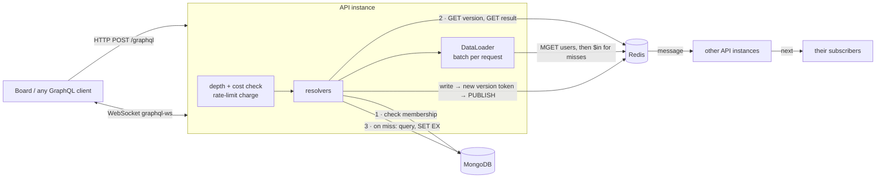

# GraphQL Task Manager

A task-board API on Node.js, Express, GraphQL and MongoDB. Redis does three jobs: it caches reads, enforces a shared rate limit, and carries live updates between API instances.

A board screen asks for a lot at once: four columns of tasks, each with its assignee, plus project stats. Done naively, one board load is a dozen MongoDB queries, plus one per task for the assignee. A GraphQL API also lets any client ask for `tasks(first: 100) { comments(first: 50) { ... } }`, which can be 5,000 objects in a single request. This API caches project reads in Redis with **versioned keys**, so a single write invalidates every cached view of that project at once. It batches user lookups with DataLoader and prices each query by how many objects it can return, before running it. That price is charged against a per-user budget kept in Redis. Task changes are pushed to every connected board over WebSocket subscriptions, through Redis pub/sub, so it works with more than one API instance.

The repo includes a small board UI that shows each response's cost and cache hits as you use it.


*Alice's board just after Bob moved WEB-12 from another client. The panel on the right lists each GraphQL request with its cost, Redis hits and misses, and server time: "0 hit / 5 miss" right after the change, "5 hit / 0 miss" on a repeat.*

## How it works



### Caching with versioned keys

[src/cache/cache.js](src/cache/cache.js) caches the expensive project-scoped reads: each task list (any filter, ordering and page) and the stats aggregation.

```
tm:ver:p:<projectId>                       -> "Xk3_9aQ"        (random token, no TTL)
tm:c:p:<projectId>:Xk3_9aQ:tasks:<argsHash> -> {"edges":[...]}  (TTL 120 s)
```

A read looks up the project's current token and then the entry under it. A write to the project replaces the token. Every cached view of that project becomes unreachable in one `SET`, with no `SCAN`, no lists of keys to track, and no need to know which filters exist. The old entries expire on their own.

Details that matter:

- **Tokens are random, not a counter.** If a version key is lost (eviction, a partial flush), a counter would restart at 1 and could land on old entries that are still cached. A random token never matches an old one. The test `never serves stale data after the version key is lost` covers this.
- **Write first, then invalidate.** A request that read the old token and is still loading stores its result under the old token, which nobody reads any more. The order doesn't allow a stale result to be cached under the current token.
- **Membership is checked before every cache read**, against MongoDB (one indexed query per request). That is what makes it safe for all members to share one cached list.
- **One version lookup per request.** A board query reads four columns and the stats. They share one token lookup and all come from the same version.
- **Single-flight.** Concurrent misses for the same key in one process share one MongoDB query. Twelve simultaneous cold requests make one or two `find`s instead of twelve. A second one happens when a straggler arrives after the first load finishes but before its result has landed in Redis.
- **The clock is part of the key** for `overdue` filters and stats, rounded to the minute, so "overdue" doesn't stay frozen in the cache.
- **Users** are cached by id (`tm:u:<id>`). The per-request DataLoader first does one `MGET` for every assignee, reporter and comment author on the page, then one `$in` query for the misses. `updateMe` deletes the key.

**Fail open.** The Redis connections used for commands have no offline queue and allow one retry. While Redis is down, every cache and rate-limit call is skipped immediately. Requests go to MongoDB, `/health` reports `degraded`, and responses show the reads as `bypassed`. Writes during the outage can't invalidate anything, so the cache records which projects changed. When Redis comes back it replaces those version tokens before it serves anything from the cache again. Without that, a Redis node that was only unreachable, not restarted, would keep serving pre-outage lists until their TTL ran out. The test `after reconnecting, invalidates projects written during the outage` fails if the replay is removed.

### Query cost, depth and rate limiting

[src/graphql/limits.js](src/graphql/limits.js) prices an operation before it runs, as roughly the number of objects it can return. Object fields cost 1 and scalars are free. In a connection, `nodes`/`edges` count `first` times. Other lists count 10 times. `logIn` and `signUp` cost 100, because bcrypt is slow on purpose.

| Query | Cost |
| --- | --- |
| `{ project(id) { tasks(first: 10) { nodes { title assignee { name } } } } }` | 13 |
| The board (4 columns × 50, stats, members) | 225 |
| `{ project(id) { tasks(first: 100) { nodes { comments(first: 50) { nodes { author { name } } } } } } }` | 5,203, rejected |

Operations over `GRAPHQL_MAX_COST` (2000) or `GRAPHQL_MAX_DEPTH` (8) are rejected with `QUERY_TOO_COMPLEX` and HTTP 400, before any resolver runs. Allowed operations charge their cost to a fixed-window budget in Redis (`INCRBY` + `PEXPIRE NX` in one `MULTI`). The budget is per user, or per IP when anonymous, and shared by all instances. Going over it returns `RATE_LIMITED`, HTTP 429 and `Retry-After`. Each response carries `extensions.cost = { requested, limit, remaining }`. The same validation and limits apply to subscriptions over WebSocket.

### Live updates

`subscription { taskEvents(projectId) { type task { ... } actor { name } } }` runs over [graphql-ws](https://github.com/enisdenjo/graphql-ws) on the same `/graphql` path. Every write publishes to `tm:ev:project:<id>`. [src/pubsub.js](src/pubsub.js) keeps one subscriber connection per process, subscribes to each channel once and fans events out locally. A consumer more than 200 events behind is closed, so a stuck socket can't grow memory without limit. The token is checked in `connection_init` (an invalid one closes with 4403), and membership is checked when a subscription starts. The tests run two API instances on shared MongoDB and Redis, write through one and receive on the other.

### Concurrent edits and board order

- **Optimistic concurrency.** Every task has a `rev`. `updateTask(..., expectedRev)` and `moveTask` only apply if the revision still matches. If it doesn't, they fail with `CONFLICT` and `currentRev`. Two simultaneous saves with the same rev: exactly one wins (tested).
- **Ordering.** Moving a card sets its `position` halfway between its new neighbours, which is a single-document write. After about 30 moves into the same gap, the gap drops below `MIN_GAP` and the column is renumbered in one `bulkWrite` (tested with 70 moves).
- **Keyset pagination.** Cursors encode the sort values plus `_id` and name their ordering. Pages don't skip or repeat rows when tasks are added mid-way, and a cursor from `PRIORITY_DESC` is rejected by `CREATED_AT_DESC`.
- Per-project task numbers (`WEB-12`) come from an atomic `$inc` on the project.

## Example

```graphql
mutation { logIn(email: "alice@example.com", password: "demo-password") { token } }
```

Send the token as `Authorization: Bearer <token>`:

```graphql
query Board($key: String!) {
  project(key: $key) {
    name viewerRole
    stats { total overdue completedLast7Days }
    open: tasks(filter: { status: [TODO, IN_PROGRESS], overdue: true }, orderBy: PRIORITY_DESC, first: 20) {
      totalCount
      pageInfo { hasNextPage endCursor }
      nodes { key title priority dueDate assignee { name } commentCount }
    }
  }
}

mutation Move($id: ID!, $after: ID, $rev: Int) {
  moveTask(input: { id: $id, status: IN_REVIEW, afterId: $after, expectedRev: $rev }) { key status rev }
}
```

The response's `extensions` for that query, run a second time on the demo data:

```json
"extensions": {
  "cost": { "requested": 25, "limit": 2000, "remaining": 19950 },
  "cache": { "hits": 2, "misses": 0, "bypassed": 0, "errors": 0, "userHits": 3, "userMisses": 0 },
  "durationMs": 3.7
}
```

The full schema is in [src/graphql/typeDefs.js](src/graphql/typeDefs.js). Errors carry a stable `extensions.code`: `UNAUTHENTICATED`, `FORBIDDEN`, `NOT_FOUND`, `BAD_USER_INPUT` (with `field`), `CONFLICT`, `QUERY_TOO_COMPLEX` or `RATE_LIMITED`. A project you aren't a member of is `NOT_FOUND`, the same as one that doesn't exist.

## Tech stack

- Node.js 22 (ES modules, no build step), Express 5
- Apollo Server 5 + `@as-integrations/express5`, graphql-js 16, graphql-ws 6 over `ws`
- MongoDB 8 via Mongoose 9 (compound indexes for every list ordering, aggregation for stats)
- Redis 8 via ioredis: cache, rate limiter, pub/sub
- DataLoader, jsonwebtoken (HS256), bcryptjs, pino
- Plain HTML/CSS/JS board with a hand-written graphql-transport-ws client
- Docker Compose; GitHub Actions running the tests against real MongoDB and Redis
- `node:test`, mongodb-memory-server

## Run it

### Docker

```bash
cp .env.example .env        # optional; set JWT_SECRET for anything public
docker compose up --build
```

Open http://localhost:4000 and sign in as `alice@example.com` / `demo-password`. A one-off `seed` container creates four demo users and two projects; it does nothing if they already exist. Also try `bob` (editor) and `dana` (viewer, read-only) in a second browser and watch changes appear live.

`docker compose --profile multi up --build` adds a second API instance on port 4001. A card moved on :4001 shows up on a board open on :4000, and both share one rate-limit budget.

### Without Docker

```bash
npm install
npm run dev
```

`npm run dev` starts a real `mongod` through mongodb-memory-server (the first run downloads MongoDB 8.0, about 800 MB). It also starts the bundled [mini-redis](devtools/mini-redis.js), a small Redis-protocol server covering only the commands this app uses, then seeds the data and serves on :4000. To use your own servers, set `MONGODB_URI` and `REDIS_URL`. `--fresh` wipes the dev data.

### Tests

```bash
npm test
```

78 tests, about 15 seconds. No API keys, no Docker, nothing mocked inside the app. Each suite runs the real server on a random port against a real `mongod` and a Redis-protocol server, and counts the MongoDB commands each request sends. Highlights:

- warm board = 0 task queries and 0 user queries; a write makes the next read miss; a mutation that reads its project back sees its own write
- 12 concurrent cold requests → at most 2 `find`s; deleting the version key never serves stale data
- Redis killed mid-test: reads and writes keep working without waiting on timeouts; on reconnect, projects changed during the outage are invalidated first; the server also starts with Redis down
- rate limit shared across two instances, with 429 and `Retry-After`; cost and depth rejection before any task query runs
- subscriptions delivered across instances, filtered by project, refused for non-members, 4403 for a bad token, cleaned up on disconnect
- permissions (owner/editor/viewer/non-member), optimistic-concurrency races, keyset paging under inserts, column rebalancing

CI sets `TEST_MONGODB_URI` and `TEST_REDIS_URL`, so the same tests run against real `mongo:8.0` and `redis:8.2` service containers.

### Benchmark

```bash
npm run bench
```

Two API servers on the same seeded data, one with the cache and one without, 300 sequential board queries each. On this machine (MongoDB on localhost, mini-redis):

| | p50 | p95 | MongoDB commands per board |
| --- | --- | --- | --- |
| `CACHE_ENABLED=false` | 7.8 ms | 11.7 ms | 16.2 |
| cached | 4.0 ms | 5.2 ms | 2.0 |

The remaining two commands are the membership check, which stays uncached on purpose, and the comment counts. With MongoDB on another host the latency gap should widen, but the main gain is the 8× drop in database load.

## Configuration

See [.env.example](.env.example).

| Variable | Default | Purpose |
| --- | --- | --- |
| `MONGODB_URI` | `mongodb://127.0.0.1:27017/taskmanager` | `npm run dev`: unset or `memory` = local mongod |
| `REDIS_URL` | `redis://127.0.0.1:6379` | `npm run dev`: unset or `memory` = mini-redis |
| `REDIS_PREFIX` | `tm:` | Prefix for every key and channel |
| `JWT_SECRET`, `JWT_TTL` | dev secret, `12h` | The server refuses to start in production with the dev secret |
| `CACHE_ENABLED` | `true` | `false` sends every read to MongoDB |
| `CACHE_TTL_SECONDS` | `120` | Cached reads. Also the most stale data can get if an invalidation is lost |
| `USER_CACHE_TTL_SECONDS` | `600` | Cached user records |
| `GRAPHQL_MAX_COST` / `GRAPHQL_MAX_DEPTH` | `2000` / `8` | Per-operation limits |
| `RATE_LIMIT_POINTS` / `RATE_LIMIT_WINDOW_SECONDS` | `20000` / `60` | Cost budget per user (or IP). `0` disables it |
| `GRAPHQL_INTROSPECTION` | on outside production | Schema introspection and the Apollo landing page |
| `TRUST_PROXY` | off | Set behind a proxy so per-IP limits see the client |
| `CORS_ORIGINS` | none | Comma-separated, for a UI on another origin |
| `BCRYPT_ROUNDS`, `LOG_LEVEL`, `PORT` | `10`, `info`, `4000` | `LOG_LEVEL=debug` logs each operation's cost and cache stats |

`/health` returns `ok`, `degraded` (Redis down) or `down` (MongoDB down, HTTP 503). `/metrics` returns cache hit rate, rate-limit rejections and pub/sub counters as JSON.

## Project layout

```
src/
  app.js                 Express + Apollo + graphql-ws wiring, limits plugin, context
  server.js / index.js   connect MongoDB and Redis, listen, graceful shutdown
  cache/cache.js         versioned project cache, user cache, fail-open, outage replay
  ratelimit.js           cost-based fixed window in Redis
  pubsub.js              Redis pub/sub -> GraphQL subscription iterators
  graphql/               schema, resolvers, cost/depth analysis
  services/              users, projects, tasks (validation, permissions, writes)
  loaders.js             per-request DataLoaders
  util/                  keyset cursors, fractional positions, validators
  demo/seed.js           demo users, projects, tasks and comments
public/                  board UI (no build step)
devtools/mini-redis.js   Redis-protocol server for dev and tests without Redis
scripts/                 dev runner, seed, benchmark
test/                    node:test suites
```

## Limitations

- **Docker Compose and CI have not been run.** The development machine has no Docker. The compose file, Dockerfile and workflow are written to work but haven't been executed. The production code path (`NODE_ENV=production`) was checked by hand against local MongoDB and Redis. So far every test run used mini-redis, not real Redis. CI is set up to run the suite against Redis 8.2.
- **Coarse invalidation.** Any write to a project invalidates all of its cached reads. That is simple and always correct, but a project taking several writes per second would rarely get a cache hit. Finer keys (per column) would mean tracking which filters a write affects.
- **Outage replay is per process.** If an instance can't reach Redis while others still can (a partition), or it crashes during an outage, other instances can serve stale lists for up to `CACHE_TTL_SECONDS`.
- **Single-flight is per process.** N instances can each run the same cold query once.
- **Subscriptions are at-most-once.** Events published while Redis is down are lost, so the board refetches when its socket reconnects. Membership is checked when a subscription starts, so a member removed mid-session keeps receiving events until they reconnect.
- **Search** is a case-insensitive regex over one project's tasks. That's fine for thousands of tasks. Beyond that, use a text index or Atlas Search.
- **Fixed-window rate limit.** A client can spend up to twice its budget across a window boundary. A sliding window needs a Lua script or sorted sets.
- **Auth** is a 12-hour JWT with no refresh or revocation; signing out only forgets the token in the browser.
- The demo company, people and tasks are made up.

## sort entries

Updated implementation details.

## acknowledge receipt

Updated implementation details.

## sort entries

Updated implementation details.